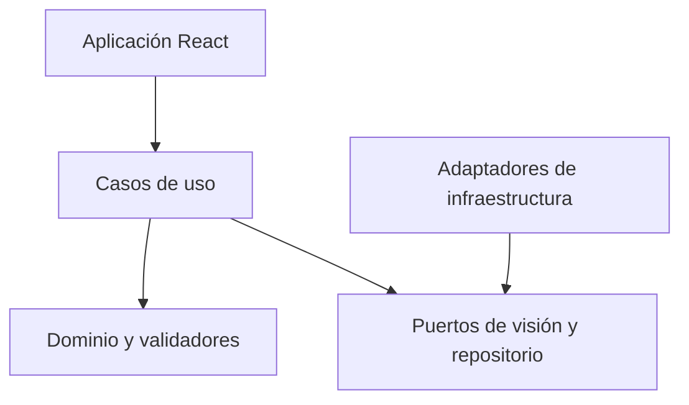

# Fase 5 — Arquitectura modular y base técnica

Versión: 0.5.0. Fecha: 2026-11-03. Alcance: frontend compilable, contratos y adaptadores de referencia; sin despliegue ni inferencia conectada.

## Dependencias y composición

La composición se centraliza en src/app/bootstrap.ts. Las vistas no importan adaptadores, y el dominio no importa React, almacenamiento, red ni componentes. El chequeo de arquitectura analiza imports con la API de TypeScript y rechaza accesos de plataforma en el núcleo. Se probó una importación prohibida de React y el chequeo la rechazó.

## Estructura implementada

| Ruta | Responsabilidad |
| --- | --- |
| src/main.tsx | Entrada, montaje y mensaje público ante configuración inválida. |
| src/app | Pantalla técnica inicial y composición de dependencias. |
| src/core/domain | Entidades, geometría, errores, validadores y transiciones. |
| src/core/ports | Interfaces VisionEngine y AnalysisRepository. |
| src/core/application | Frontera que valida entrada y salida del motor inyectado. |
| src/infrastructure/persistence | Repositorio VOLÁTIL de contrato, copias y restauración validada. |
| src/infrastructure/vision | Motor no conectado que falla explícitamente. |
| src/shared | Configuración pública validada. |
| src/modules | Espacio reservado a módulos de la Fase 6; sin carpetas vacías ficticias. |
| tests/ts | Pruebas de contratos, repositorio, motor y configuración. |
| scripts | Guard de dependencias de arquitectura. |
| tools y tests | Referencias y pruebas Python de fases previas. |

## Contratos tipados

AnalysisInput conserva ID, correlación, actor, organización, recurso orientado y configuración versionada. La fuente exige assetId, SHA-256, dimensiones y orientation=already-oriented. El contrato limita dimensiones y píxeles según los presupuestos propuestos; no decodifica el archivo ni mide memoria por sí solo.

VisionEngine recibe esa entrada y devuelve unknown en la frontera: el caso de uso la valida antes de considerarla VisionResult. El adaptador debe declarar origen y no puede cambiar de DEMO a REAL silenciosamente. Los motores de fixture usados en tests viven solo en tests/ts; no constituyen un detector.

VisionResult valida identidad, huella, versión de escenario, clases habilitadas, IDs únicos, cajas, máscaras RLE y evidencia de patrones. El resultado real exige modelVersion; un resultado demo no se presenta como modelo entrenado. Las máscaras se refieren a la imagen canónica y los patrones a evidencias existentes.

AnalysisRepository permite crear, consultar, listar, cambiar estado y guardar resultado con comparación de versión. commitResult valida y prepara el resultado y el estado antes de un único reemplazo; transition no permite marcar completed sin ese resultado. Las lecturas y escrituras usan copias para no filtrar referencias mutables.

## Persistencia y migración

El adaptador de esta fase usa un Map y es **volátil**: sus datos se pierden al recargar o crear otra instancia. No se presenta como persistencia del usuario ni como IndexedDB. Su finalidad es probar el contrato y el comportamiento atómico dentro del proceso JavaScript.

El formato analysis-repository-v1 conserva una lista de AnalysisRecord. restoreSnapshot valida la versión, todos los registros y los IDs únicos antes de reemplazar el mapa completo. Una copia corrupta o de versión desconocida se rechaza y deja intacta la actual.

Solo hay esquema v1; no se inventa una migración desde versiones que aún no existen. Antes de cambiarlo: exportar copia, definir migración pura, validar resultado completo, probar compatibilidad y cambiar almacén solo después. La persistencia durable y sus transacciones, cuota e interrupciones reales se implementan en Fase 7. Una restauración válida reemplaza el contenido del adaptador y requiere confirmación cuando la futura UI la exponga.

## Estados y validación temporal

Se conservan los estados de Fase 4, la correlación y el control de versión. Internamente TypeScript utiliza instantes UTC canónicos con milisegundos; un límite de API que reciba otras zonas deberá normalizarlas antes de crear registros. Esto no cambia la comparación de instantes especificada en Fase 4.

El motor no conectado siempre devuelve ENGINE_UNAVAILABLE. Tener VITE_VISION_MODE=real y URL válida no activa un modelo: todavía no existe ApiVisionAdapter real. La pantalla indica que el motor no está conectado. El adaptador demo de escenarios se integrará en Fase 7 y el real en Fase 15.

## Seguridad de configuración

VITE_* es público y se incluye en el cliente; no poner claves ni contraseñas. La configuración admite demo por defecto. Real exige URL base HTTPS, salvo HTTP local para desarrollo. Se rechazan credenciales en URL, consulta y fragmento para no incluir secretos ni alterar la ruta base por accidente. Esto no sustituye la autorización de un servidor ni es un validador de destinos SSRF de backend.

## Decisiones de herramientas

React y Vite se utilizan según el plan; TypeScript es estricto y Vitest prueba el núcleo sin DOM. Se seleccionó TypeScript 6.0.3 porque el guard usa su API de compilador; TypeScript 7.0.2 probado en este entorno expone su CLI pero no esa API y no se mantuvo en las dependencias finales. Las dependencias directas están fijadas y package-lock.json conserva resoluciones e integridad.

Referencias consultadas: [React con una herramienta de compilación](https://react.dev/learn/build-a-react-app-from-scratch), [Vite](https://vite.dev/guide/) y [React con TypeScript](https://react.dev/learn/typescript). Las versiones efectivas se verificaron además con metadatos del registro e instalación local.
