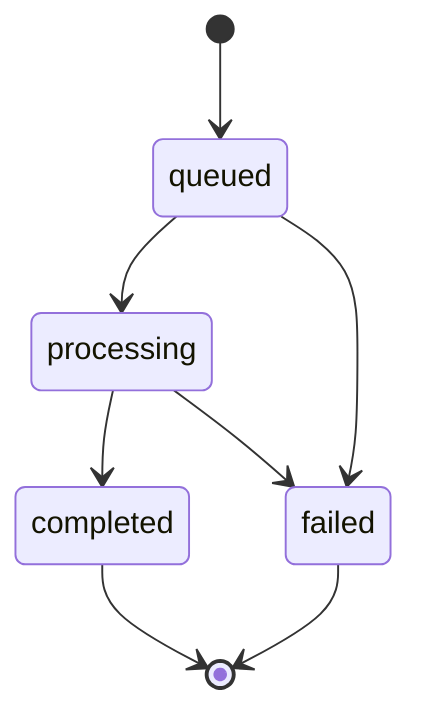
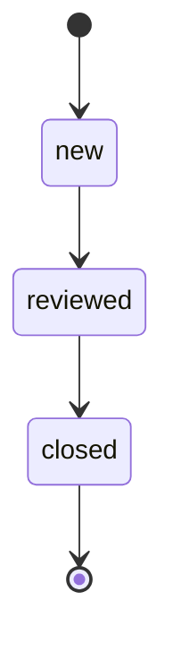

# Estados, concurrencia y conservación de resultados

Versión: business-contract-v1. El código es una referencia pura e inmutable: no posee base de datos, autenticación, tareas remotas ni cancelación de trabajos.

## Análisis

| Estado | Etiqueta visible | Condición |
| --- | --- | --- |
| queued | En cola | Ejecución creada con entrada validada. |
| processing | Procesando | Motor invocado para esa ejecución. |
| completed | Completado | Resultado validado y persistencia confirmada. |
| failed | Error | Código de fallo registrado y entrada recuperable cuando proceda. |

No se permite queued a completed, reiniciar un análisis terminal ni repetir una transición sin cambiar versión. Un reanálisis crea otro ID y registra retryOfAnalysisId o una relación equivalente. La referencia no genera esos intentos; el caso de uso posterior lo implementará.

Cada evento identifica analysisId, correlationId, expectedVersion y occurredAt. La versión es entero positivo y el instante incluye zona horaria. Se rechazan eventos de otra ejecución, versiones antiguas y fechas anteriores al estado confirmado. Comparar instantes en UTC aunque se almacene el texto original con zona.

La finalización exige resultValidated=true y resultPersisted=true como booleanos estrictos. En esta referencia son precondiciones suministradas por el llamador; el backend debe calcularlas a partir de validadores y resultado real de escritura, nunca confiar en un cliente que las envía.

El indicador de UI observa el estado confirmado. Timeout de petición no implica cancelación del motor. Antes de repetir una petición real, consultar trabajo e idempotencia para no duplicar ejecuciones. La política de idempotencia de transporte queda por implementar en la API.

## Alertas

| Transición | Requisitos | Efecto |
| --- | --- | --- |
| new a reviewed | Supervisor o administrador autorizado, versión actual y nota | Registrar revisor, fecha, observación y versión. |
| reviewed a closed | Permiso, versión actual y nota de cierre | Añadir evento; conservar revisión anterior. |

No existe cierre directo de new ni reapertura en esta versión. Incorporar reapertura requeriría nueva decisión y pruebas. La nota admite 1 a 2000 caracteres, sin permitir solo espacios. El instante no puede retroceder y dos revisores con la misma versión no deben sobrescribirse en servidor.

Los cambios generan otra instantánea y un evento de revisión; nunca reescriben las detecciones, confianza, máscaras o configuración del análisis que originó la alerta. La persistencia del historial y la escritura atómica se incorporan después.

## Filtros y configuración

- Filtro de clase, confianza o capa: cambia una consulta o representación.
- Resultado bruto: permanece asociado a la ejecución; no se borra al ocultar detecciones.
- Regla aplicada: se conserva su versión y condición de ejecución.
- Modificar regla o catálogo: crear versión; no reinterpretar resultados antiguos silenciosamente.
- Exportar: utiliza la consulta y fecha de corte registradas sin alterar historial.

La función de filtrado de la Fase 2 ya comprueba que la lista bruta permanezca intacta. No deben ejecutarse reglas sobre una lista que el usuario acaba de filtrar si ello cambia la evidencia original.

## Errores y recuperación

El catálogo [errores.json](errores.json) separa código técnico, mensaje público y recuperación. Los 10 errores de contratos de referencia están implementados; los otros 10 están especificados para futuras fases. No devolver stack traces, secretos ni información de recursos ajenos en la UI.

Una autorización positiva solo permite continuar evaluando la operación. No sustituye reglas adicionales de elegibilidad, confirmación destructiva, validación, idempotencia ni escritura consistente. En particular, retention.delete requiere política y confirmación además del rol.
