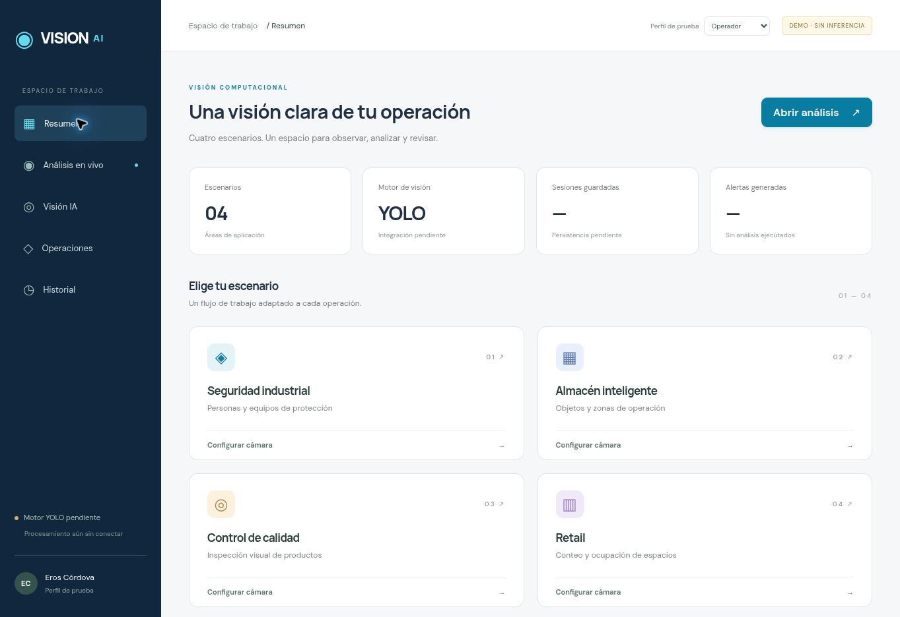
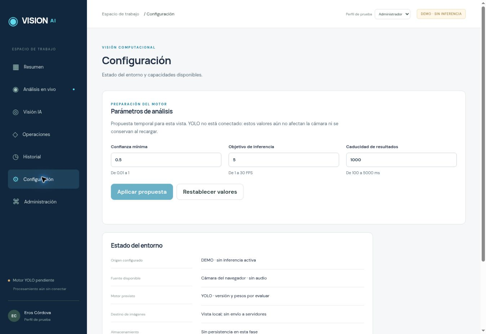

# Evidencias Fase 6 — incremento inicial

Fecha: 2026-11-03. Referencia: manual 5.0, D12 y diseno_ui.md.

## Verificado

- Guard de arquitectura y tipos estrictos correctos.
- 54 pruebas TypeScript aprobadas, incluidas cuatro nuevas de propiedad de cámara: permiso tardío tras cancelación, pausa/reanudación/stop, reemplazo concurrente y reintento tras rechazo.
- Build Vite correcto; sin motor, backend ni persistencia añadidos.
- Navegador: Resumen → Análisis en vivo; cambio Seguridad industrial → Retail; Historial; Configuración restringida al operador; acceso al cambiar a administrador; Administración; perfil auditor sin ejecución.
- Vista de escritorio inspeccionada visualmente en Resumen y Análisis.
- El preview HTTP no es contexto seguro para getUserMedia: mensaje de error comprobado. No se elude esa restricción.

## No acreditado

Cámara real, permisos aceptados en navegador, pruebas de hardware, tres tamaños exigidos, accesibilidad integral, YOLO, latencia, seguimiento, máscaras, alertas ni almacenamiento durable. RT01/RT02 tienen evidencia parcial de controlador y error; siguen pendientes de integración.

No se aprueba el cierre completo de Fase 6. Próximo incremento: completar componentes y pruebas responsive/accesibilidad y cámara en contexto seguro, antes de Fase 7.

## Captura de escritorio

## Segundo incremento — componentes y confirmación de cámara

Confirmación del usuario: «ya funciona». La cámara funciona en su equipo; falta recorrer todos los casos de integración RT.

- 57 pruebas TypeScript aprobadas; tres nuevas prueban límites válidos, números no finitos/fraccionarios y rangos inválidos de configuración temporal.
- Formulario: confianza 2 rechazada, foco en el campo; 0.65 aceptada con aviso de propuesta temporal.
- Modal: Escape cierra y restaura foco a Restablecer valores.
- Historial: búsqueda cambia estado vacío, limpiar restablece; botones de paginación deshabilitados sin registros.
- Contraste de textos secundarios reforzado. Sin auditoría integral de contraste aún.
- Se revisó escritorio; no se acredita 360/768/1440. El zoom no alteró la anchura del viewport.
- Logs consultados: aparecen errores de una extensión del navegador; no se atribuyen al código de la aplicación.

Estado: Fase 6 en curso. Continúan pendientes visor de resultados por capa, estados de ejecución con fixtures y QA responsive/accesible integral. No hay YOLO ni persistencia.

## Tercer incremento — recorrido guiado de la Fase 6

Se reordena la pantalla de análisis para que el recorrido sea **1. Elegir escenario → 2. Iniciar cámara → 3. Revisar resultados**. La selección desmonta la cámara anterior mediante la clave de escenario; cada paso expresa su estado, incluida solicitud, pausa, fallo y vista previa. El perfil auditor mantiene la cámara inaccesible. Los resultados permanecen visibles como panel de consulta, pero claramente no disponibles hasta validar YOLO: no se dibujan cajas, máscaras ni cifras inventadas.

Pruebas unitarias añadidas para los cinco estados de la cámara y para no confundir vista previa con inferencia. La validación CI (tipos, arquitectura, pruebas y compilación) debe comprobarse en el commit de este incremento. **No** se acredita todavía QA responsive de hardware real ni cierre de Fase 6.

## Cuarto incremento — visor de fotogramas vinculados

Se añade el componente de visor para fotogramas efectivamente analizados, con imagen de igual orientación y dimensiones, cajas normalizadas, máscaras RLE por filas y lista de patrones. Los controles permiten mostrar y ocultar cada capa. La confianza se presenta como puntuación del detector, no como porcentaje de aciertos.

El visor requiere coincidencia estricta de sesión, generación, ID de fotograma, instante monotónico, versión de configuración, assetId y hash de contenido. Solo admite resultados origin=real con modelVersion, valida cajas y máscaras y oculta anotaciones si el resultado tiene más de 1000 ms, no carga la imagen o la geometría no coincide. La cámara local sigue separada y no envía fotogramas al visor hasta disponer de adaptador YOLO, por lo que en producción se muestra el estado vacío.

Se añaden pruebas de lógica de sincronización y máscaras y una auditoría automatizada de anchuras de pantalla en 360, 768 y 1440 px. Los resultados de CI, compatibilidad real y revisión manual se documentan al verificarse; **no** equivale aún a despliegue ni a inferencia en vivo.

## Quinto incremento — motor real para simulaciones de video

Por cambio solicitado, se incorpora un piloto de backend FastAPI con Ultralytics YOLO26n: video local en bucle o cámara, JPEG de un fotograma a la vez y detecciones sin resultados prefabricados. API enlazada a localhost, fuente explícita, pausa/cancelación y descarte de resultados tardíos. Los cuatro escenarios comparten flujo, pero la cobertura depende de clases reales presentes en pesos. Persona genérica sirve como primera verificación de retail; EPP, montacargas y defectos necesitan pesos especializados.

Se añaden pruebas Python puras del protocolo y de cobertura y validación CI. Los paquetes de IA y el checkpoint no se instalan en GitHub Actions: aprobar CI no demuestra FPS, precisión, ejecución de pesos, seguridad productiva o simulación probada en el equipo. Permanece pendiente QA end-to-end en hardware local.
