# Galería de referencias de Fase 3

Diagramas propios preparados, identificados como DEMO. No son resultados de un detector ni fotografías de una empresa.

## Seguridad industrial

### positive — triggered

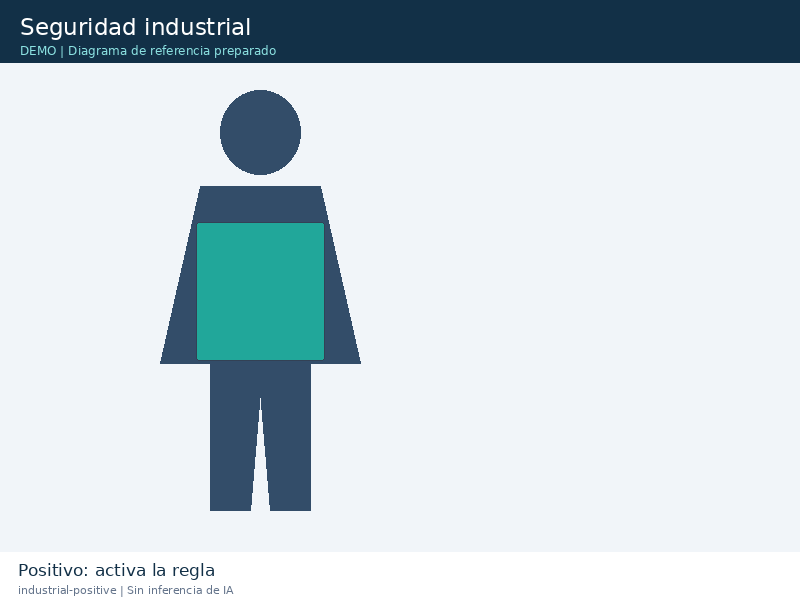

### negative — not-triggered

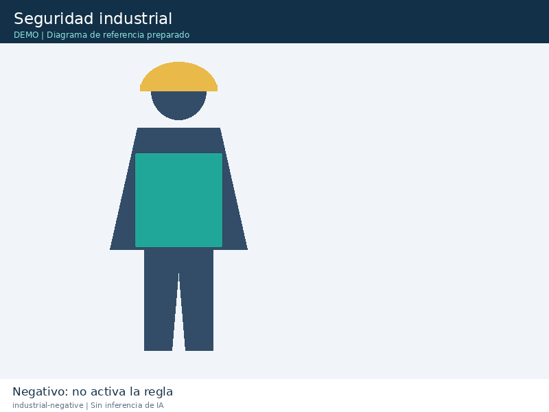

### ambiguous — indeterminate

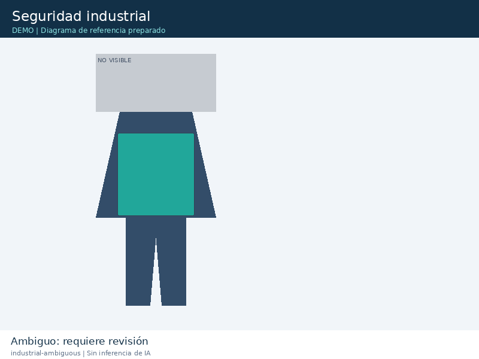

## Almacén inteligente

### positive — triggered

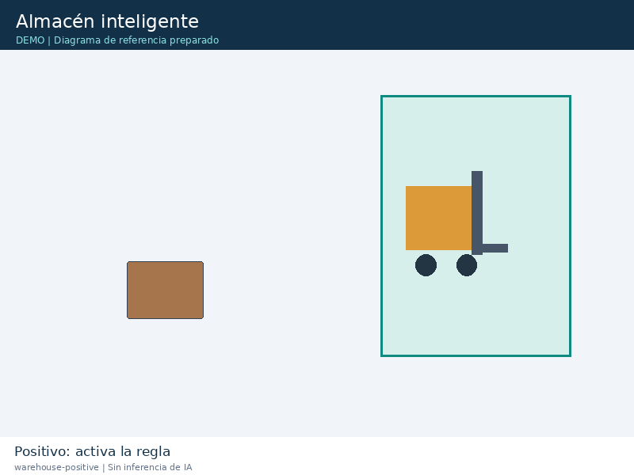

### negative — not-triggered

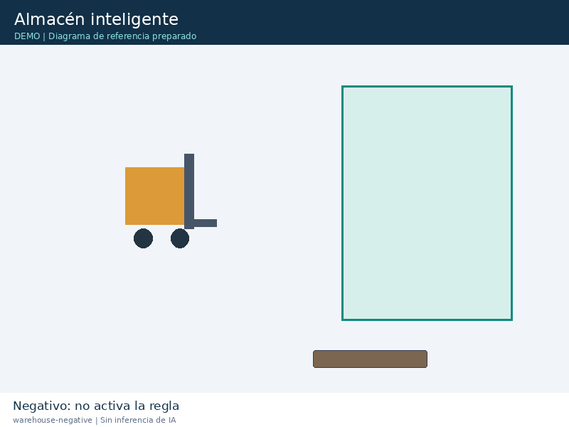

### ambiguous — indeterminate

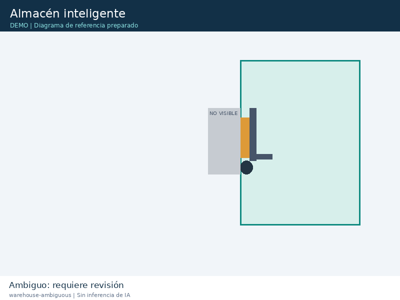

## Control de calidad

### positive — triggered

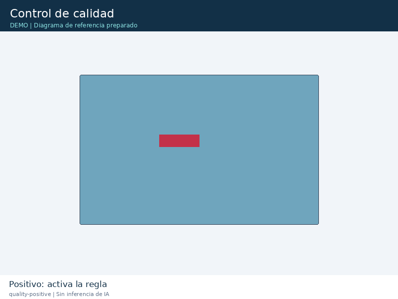

### negative — not-triggered

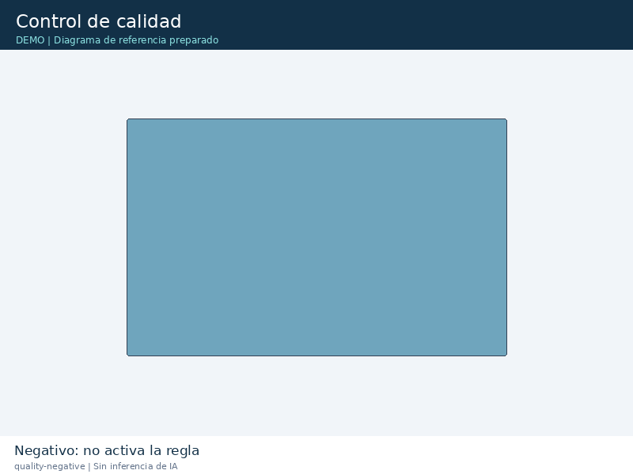

### ambiguous — indeterminate

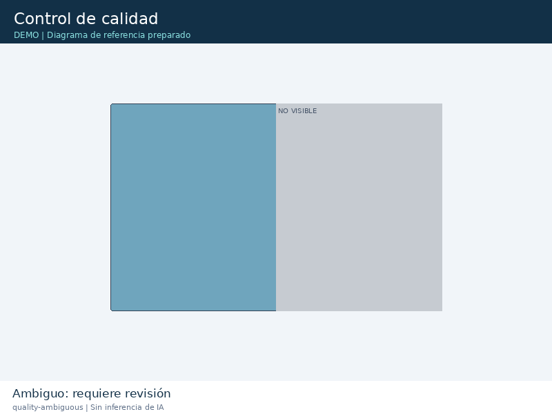

## Retail

### positive — triggered

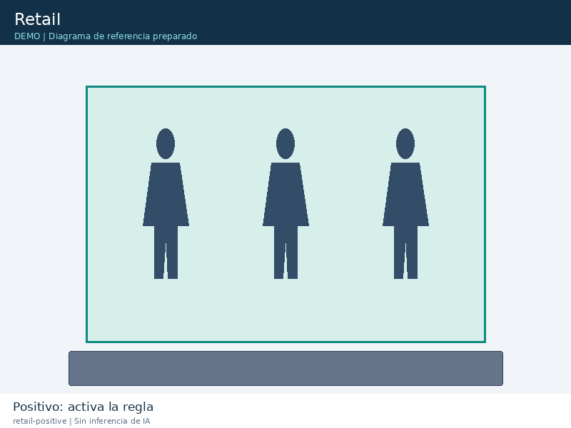

### negative — not-triggered

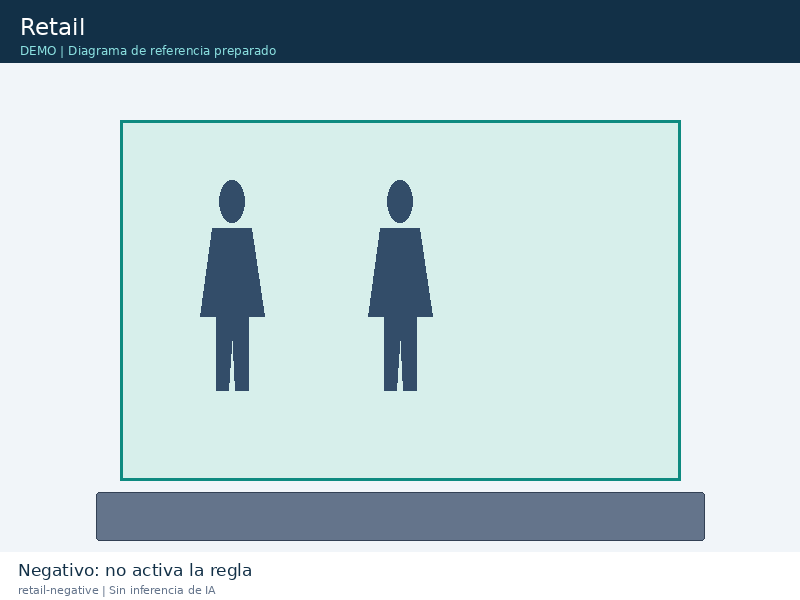

### ambiguous — indeterminate

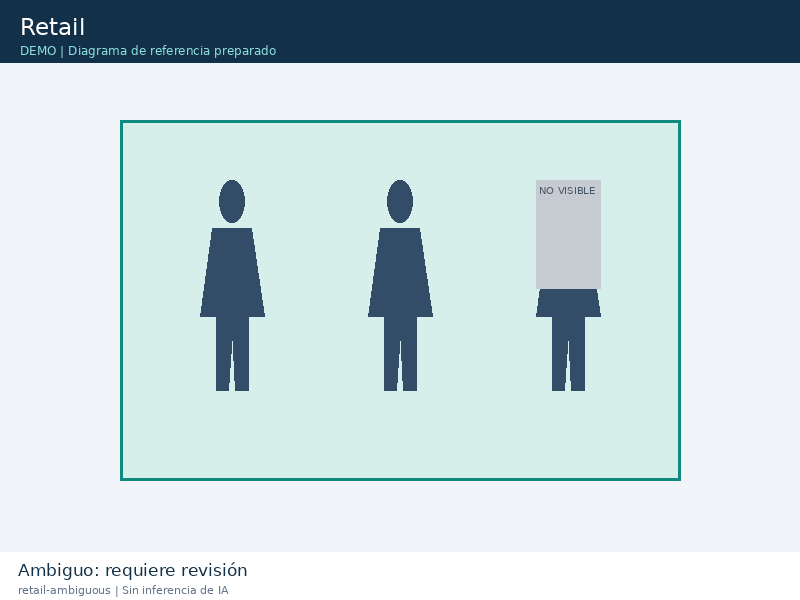

