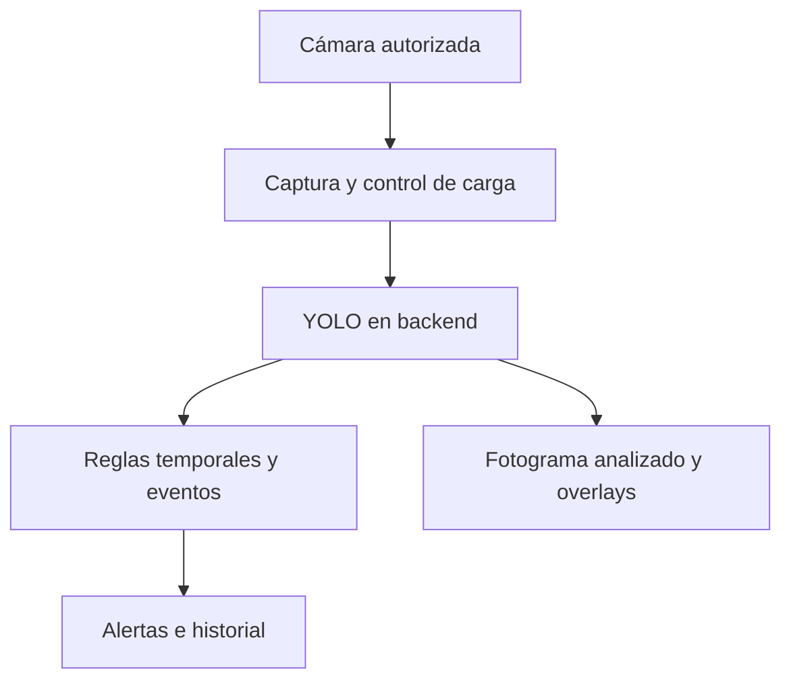

# YOLO y análisis en tiempo real — cambio de alcance D12

Fecha: 2026-11-03. Requisito explícito del usuario: utilizar YOLO y trabajar con los escenarios en tiempo real. Este documento sustituye las exclusiones anteriores de cámara en vivo y seguimiento temporal limitado.

## Decisión tecnológica

- Motor de visión: **familia YOLO**. La versión, tamaño, formato de exportación y pesos se fijarán después de comparar cobertura, precisión, memoria y latencia en el hardware disponible. No se instala un paquete ni se descarga un modelo sin esa elección.
- Detección con cuadros y segmentación con máscaras requieren tareas/modelos adecuados. No afirmar que un detector de cajas genera máscaras automáticamente.
- Adaptador real previsto: Python + FastAPI + YOLO, con sesión de procesamiento y transporte de fotogramas/resultados. La inferencia puede ejecutarse localmente; no se exige contratar un servicio de pago.
- Fuente inicial: webcam del navegador, elegida por el usuario. Cámara IP/RTSP se contempla como segundo conector del backend, con red alcanzable y destino autorizado; el navegador no recibe credenciales de RTSP ni conecta directamente a ese protocolo.
- El backend y la integración real siguen pendientes de implementación. Las referencias diagramáticas existentes no se superponen sobre cualquier cámara como si fueran predicciones.

## Flujo previsto

Una sesión agrupa muchos fotogramas. Capturar no implica guardar video ni publicar imágenes: la UI debe indicar destino de procesamiento antes de conectar, y enviar solo mientras la sesión esté activa. Sin audio por defecto.

## Experiencia en Fase 6

1. Elegir escenario y dispositivo, comprobar la fuente y pulsar Iniciar cámara.
2. Solicitar permiso del navegador y mostrar preview; permiso rechazado o dispositivo ausente tienen salida clara.
3. Conectar análisis únicamente a un motor disponible. Preview de cámara no equivale a inferencia YOLO.
4. Mostrar fotograma efectivamente analizado con sus cajas/máscaras, fecha y antigüedad; conservar preview fluido como vista diferenciada si el análisis tiene otra cadencia.
5. Pausar detiene nuevos envíos; al detener, liberar tracks y conexión y descartar respuestas tardías. Un cambio de escenario/configuración inicia otra generación.
6. No dibujar un resultado antiguo como si correspondiera al video actual; retirar overlays caducados.

La captura requiere permiso y contexto seguro del navegador. La cámara se solicita por acción explícita, no al abrir la página. Si el usuario deja la petición sin responder, la UI conserva el estado de solicitud y ofrece cancelar; si el permiso llega después de cancelar, debe liberar los tracks.

## Escenarios en vivo

| Escenario | Capacidad temporal | Condición de datos/modelo |
| --- | --- | --- |
| Seguridad industrial | Personas y EPP por instancia; condición repetida revisable sin alertar en cada fotograma. | Clases casco/chaleco, asociación persona-EPP y oclusiones evaluadas; no asumirlas por elegir YOLO. |
| Almacén inteligente | Montacargas y objetos respecto de zona calibrada; seguimiento temporal y deduplicación de episodio. | Modelo con las clases requeridas y zona recalibrada si cambia cámara o encuadre. |
| Control de calidad | Inspección de productos que pasan ante la cámara; región defectuosa y revisión por producto/episodio. | Pesos y máscaras de los defectos concretos; un modelo genérico no certifica calidad. |
| Retail | Conteo/ocupación actualizado y seguimiento anónimo dentro de la sesión. | Un ID de track no es una identidad personal ni garantiza personas únicas entre sesiones. |

El sistema no promete reconocer todas las clases de cada escenario con un único modelo genérico. Las reglas temporales usan resultados reales y versionan condiciones; un tracker reduce duplicados pero puede cambiar IDs por oclusión.

## Contratos de sesión y fotograma

Se añaden [tipos de sesión](../src/core/domain/realtime.ts) y el [puerto RealtimeVisionEngine](../src/core/ports/realtime-vision-engine.ts). Son contratos tipados, no un adaptador implementado.

| Campo | Significado |
| --- | --- |
| sessionId y generation | Identidad y época; cambia al reiniciar o cambiar configuración. |
| frameId | Secuencia creciente dentro de una generación; no reutilizar al reconectar. |
| capturedAtMonotonicMs | Reloj monotónico del cliente, conservado para medir captura a dibujo en ese mismo equipo. |
| configurationVersion | Escenario, umbral, zona y modelos aplicados al fotograma. |
| source y result | Imagen orientada, huella, dimensiones y contrato visual existente. |
| modelFamily y modelVersion | YOLO y pesos/configuración efectivos; no habilitar REAL sin validación. |

El tiempo de inferencia se mide con reloj del backend y se comunica como duración, no se resta un timestamp de otro equipo. Capture FPS e inference FPS se muestran por separado. El preview puede ser fluido aunque el detector procese menos fotogramas.

## Control de carga y sincronización

- Una inferencia activa y como máximo un fotograma pendiente por sesión. Un nuevo pendiente reemplaza al anterior: no crece una cola sin límite.
- Con transporte lento se reduce frecuencia y se descartan pendientes antiguos; registrar descartes y congestión. Vigilar bufferedAmount si se usa WebSocket.
- Rechazar resultados de otra sesión, generación o configuración y secuencias ya procesadas. Rechazar resultados fuera de la antigüedad permitida.
- El visor analizado muestra el fotograma exacto de la inferencia, con escalas y márgenes de esa imagen. Mirroring de selfie debe transformar imagen y overlays juntos, no solo uno.
- Pausa, stop, logout, cambio de cámara y navegación deben limpiar timers, callbacks, conexión y recursos. No mantener capturas ocultas por defecto.
- WebSocket es la propuesta inicial para frames y resultados; el protocolo binario, autenticación y límites se validan al implementar. No hay endpoint activo.

## Reglas temporales e historial

No persistir cada fotograma como Analysis ni guardar el video completo. Conservar SessionSummary, eventos, métricas agregadas y capturas pertinentes según política; el análisis puntual de imágenes permanece como herramienta complementaria.

Propuesta inicial: exigir condición observable durante al menos 1 segundo, con separación máxima de 500 ms entre observaciones válidas, y cooldown de 10 segundos por sesión/regla/track/episodio. Son parámetros de ejemplo configurables para probar, no protocolos industriales. Una oclusión o intervalo excesivo rompe la acumulación; no se interpreta como evidencia negativa ni cierra una alerta humana automáticamente.

La referencia de frontera espacial y filtros continúa siendo válida por fotograma. Reglas ejecutadas sobre datos brutos, control de versiones y revisiones no se alteran por ocultar una capa. Si un tracker cambia ID, declarar la limitación de deduplicación; no prometer conteo único perfecto.

## Presupuestos iniciales por medir

| Parámetro | Propuesta | Condición |
| --- | --- | --- |
| Fuente | Una cámara por sesión piloto | No implica sistema 24/7 ni múltiples cámaras simultáneas. |
| Resolución enviada | Lado mayor hasta 640 px al comenzar | Ajustar por calidad de objetos pequeños y tarea; conservar transformación. |
| Inferencia objetivo | 5 FPS configurables, reducción adaptativa | Es objetivo inicial; la tasa real depende de cámara, red, CPU/GPU y modelo. |
| Captura a dibujo p95 | Objetivo <= 500 ms | Medir en cliente sobre el mismo fotograma, al menos 100 respuestas tras calentamiento. |
| Overlay | Caducar después de 1000 ms | Ocultar y marcar desactualizado; no mostrar una caja vieja sobre otra escena. |
| Sesión piloto | 10 minutos de prueba sostenida | Medir memoria, recursos y descartes sin crecimiento indefinido. |
| Registro | Eventos y resumen; sin video bruto por defecto | Retención y capturas explícitas, permisos por sesión y recurso. |

Estos presupuestos reemplazan la suposición de medir tiempo real con un timeout de análisis puntual. Los 10 MiB y 20 MP de imágenes siguen aplicando a carga puntual, no son objetivos de transporte de cada fotograma.

## Pruebas nuevas obligatorias

| ID | Comprobación | Fase |
| --- | --- | --- |
| RT01 | Permiso aceptado, denegado, sin cámara y solicitud pendiente; sin captura automática. | 6 |
| RT02 | Pausa/stop limpian callbacks, tracks y conexión; respuesta tardía ignorada. | 6 y 9 |
| RT03 | Sobrecarga mantiene 1 inferencia + 1 pendiente y no crece memoria. | 5, 9 y 14 |
| RT04 | No dibujar frames fuera de orden, otra generación/configuración o caducados. | 9 y 10 |
| RT05 | Geometría, giro y mirroring alineados al fotograma analizado. | 6 y 10 |
| RT06 | EPP, zona, defecto y ocupación en secuencias positivas, negativas y ambiguas. | 3, 11 y 15 |
| RT07 | Un episodio no crea una alerta por frame; oclusión y cambio de track se controlan. | 11 |
| RT08 | Desconexión y reconexión autorizada sin sesiones ajenas ni captura oculta. | 9 y 13 |
| RT09 | FPS, latencia y memoria medidos durante sesión sostenida con pesos YOLO. | 14 y 15 |
| RT10 | Recursos y CPU/GPU de alojamiento sostienen la cadencia medida. | 16 |

Todos los casos RT están **pendientes**. Los 112 tests existentes no acreditan cámara, WebSocket, tracking ni inferencia YOLO.

## Impacto en el plan

Se conserva la numeración de 16 fases y la interfaz en Fase 6. Fases 1 a 5 mantienen la evidencia de la base previa; las ampliaciones temporales requieren validaciones nuevas y no aumentan el porcentaje por documentarlas. Hito demo prueba captura y estados identificados; solo la integración de Fase 15 acredita detección YOLO en vivo. La entrega real exige los cuatro escenarios validados y operación sostenida en Fase 16.

Se mantienen fuera de alcance inicial: biometría, grabación masiva, vigilancia autónoma 24/7, comunicaciones externas automáticas y garantías de FPS sin medición.

## Fuentes técnicas

- [Ultralytics Predict: imágenes, video y streams](https://docs.ultralytics.com/modes/predict/).
- [Ultralytics Track: seguimiento entre fotogramas](https://docs.ultralytics.com/modes/track/).
- [Ultralytics Segment: máscaras por instancia](https://docs.ultralytics.com/tasks/segment/).
- [Ultralytics Train: entrenamiento con datos propios](https://docs.ultralytics.com/modes/train/).
- [MDN getUserMedia](https://developer.mozilla.org/en-US/docs/Web/API/MediaDevices/getUserMedia).
- [MDN requestVideoFrameCallback](https://developer.mozilla.org/en-US/docs/Web/API/HTMLVideoElement/requestVideoFrameCallback).
- [MDN WebSocket bufferedAmount](https://developer.mozilla.org/en-US/docs/Web/API/WebSocket/bufferedAmount).

## Incremento piloto — simulación en tiempo real sobre video (2026-11-03)

Se implementa un camino vertical de **inferencia verdadera** sin prometer capacidades de un modelo genérico:

- Fuente 1: archivo de video local que se reproduce en bucle a su velocidad natural; solo se envían imágenes cuando el usuario inicia análisis explícitamente.
- Fuente 2: cámara del navegador con permiso y estado de pausa/stop.
- Captura de fotogramas JPEG del elemento de video (lado mayor 640 px); una solicitud HTTP en vuelo, siguiente fotograma tras finalizar la anterior. No se crea una cola de imágenes antigua. Este transporte HTTP es el piloto local previo al WebSocket escalable de Fase 9.
- Backend FastAPI en loopback, YOLO26n base sobre CPU y opción de sustituir pesos por escenario desde rutas locales confiables.
- Resultado vinculado a sessionId, generation, frameId, timestamp monotónico, hash exacto del JPEG, modelo y configuración. El visor rechaza otras identidades y retira anotaciones caducadas.
- El backend no guarda archivos; CORS restringido a localhost. No usar como servicio público sin identidad, TLS y límites de abuso.
- La detección genérica de personas puede aprovecharse en retail; no inferir incumplimiento de EPP, montacargas o defectos con clases ausentes del modelo. Las alertas se mantienen deshabilitadas hasta integrar reglas comprobadas.
- Ultralytics YOLO26 tiene licencia AGPL-3.0/Enterprise. Alternativa a evaluar: RF-DETR Nano (pesos Apache 2.0) y comparativa real de CPU, memoria, FPS, mAP y uso de licencia antes de decidir motor final.

Para levantar el piloto, ver [backend/README.md](../backend/README.md). No sustituye las fases 9–15 ni los criterios de aceptación en tiempo real.
